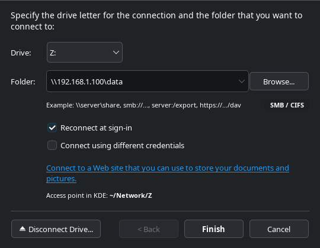
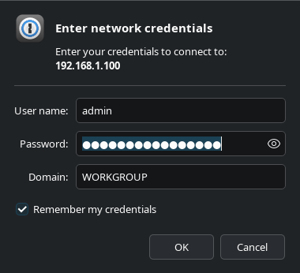
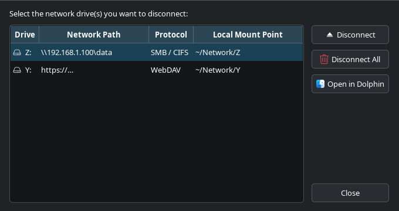

# DriveMounter 🌐 (KDE Plasma)

<p align="center">
  <a href="https://github.com/Shieldowskyy/drivemounter/actions/workflows/tests.yml"></a>
  <a href="https://opensource.org/licenses/MIT"></a>
  <a href="https://www.python.org/"></a>
  <a href="https://kde.org/"></a>
</p>

A pixel-perfect 1:1 recreation of the classic Windows **Map Network Drive** wizard, built natively for **KDE Plasma** using **PyQt6** and the native **Breeze** design system.

Seamlessly mount remote network storage on Linux with the familiar Windows workflow: choose a drive letter (`Z:` to `D:`), enter the network path or browse, configure auto-reconnect on sign-in, and provide network credentials.

---

## 📸 Screenshots

<p align="center">
  
</p>

<p align="center">
  
  &nbsp;&nbsp;&nbsp;&nbsp;
  
</p>

---

## 🌟 Key Features

- **1:1 Windows Map Network Drive Wizard Workflow:**
  - Exact layout, field order, keyboard shortcuts, and UX matching Windows.
  - Drive letter selector (`Z:` down to `D:`), prioritizing highest available letter.
  - Smart folder input supporting Windows UNC paths (`\\server\share`) as well as standard UNIX URIs.
  - **Browse...** button with live network scanning for SMB workgroups, servers, and shares.
  - **Reconnect at sign-in** checkbox via standard XDG Autostart.
  - **Connect using different credentials** checkbox prompting the exact **Windows Security** style modal.
  - **Connect to a Web site** link launching the WebDAV / Nextcloud / ownCloud connection wizard.
  - **Disconnect Drive...** button for direct management and unmounting of mapped shares.

- **KDE Plasma & Linux Native Integration:**
  - 100% native Qt6 Breeze styling, automatically inheriting active color scheme (Breeze Dark / Breeze Light).
  - Uses native KDE Breeze icons (`drive-network`, `network-server`, `media-eject`, `dialog-password`).
  - **KDE Dolphin Integration:**
    - **Places Sidebar:** Mapped drives automatically appear in Dolphin's **Places** panel with network drive icons.
    - **Context Menu (Service Menu):** Right-click anywhere or on folders in Dolphin to trigger **"Map Network Drive..."** or **"Disconnect Network Drive..."**.
  - **KDE System Settings:** Native `.desktop` integration registered directly under the **Network** module in KDE System Settings and KRunner.
  - **File System Access:** Every drive is mapped to `~/Network/<Letter>` (e.g., `~/Network/Z`), making it instantly accessible to Linux applications, CLI tools, Wine, and Steam Proton.
  - Native desktop notifications on mount/unmount via KDE notification daemon.

- **Full Protocol Support:**
  - **SMB / CIFS:** Windows Shares & Samba (user-space via GIO/GVfs or cifs-utils).
  - **NFS:** Network File System exports (`server:/export` or `nfs://server/export`).
  - **WebDAV:** Nextcloud, ownCloud, NAS WebDAV, or HTTP(S) servers (`https://.../dav`).

- **Multilingual Support (English Priority):**
  - English is the default and prioritized language, matching original Windows phrasing.
  - Polish localization is built-in and switchable via `--lang pl` or settings.

---

## 📦 System Dependencies

Ensure the required system tools and network clients are installed for your distribution:

### Ubuntu / Debian / Kubuntu
```bash
sudo apt update
sudo apt install python3 python3-venv python3-pip cifs-utils nfs-common davfs2 smbclient libnotify-bin
```

### Fedora
```bash
sudo dnf install python3 python3-pip cifs-utils nfs-utils davfs2 samba-client libnotify
```

### Arch Linux / Manjaro
```bash
sudo pacman -S python python-pip cifs-utils nfs-utils davfs2 samba libnotify
```

---

## 🚀 Getting Started

### Quick Install (Default with Python `venv`)

The repository includes a dedicated `setup.sh` that automatically creates an isolated virtual environment (`.venv`), installs dependencies, generates the desktop shortcut, and links `drivemounter` into your `~/.local/bin`:

```bash
# Clone the repository
git clone https://github.com/Shieldowskyy/drivemounter.git
cd drivemounter

# Run the automated setup script (uses .venv by default)
./setup.sh
```

### Manual Setup with `venv`

If you prefer to configure the virtual environment manually:

```bash
# 1. Create and activate virtual environment
python3 -m venv .venv
source .venv/bin/activate

# 2. Install dependencies & package in editable mode
pip install --upgrade pip
pip install -e .

# 3. Link launcher to your local path
mkdir -p ~/.local/bin
ln -sf "$(pwd)/bin/drivemounter" ~/.local/bin/drivemounter

# 4. Install KDE Application Menu (.desktop) entry
drivemounter --install-desktop
```

### Package Installation (Debian / Ubuntu / Fedora)

#### Debian / Ubuntu / Kubuntu (`.deb`)
```bash
# Build locally or download from GitHub Releases
./packaging/build_deb.sh
sudo apt install ./dist/drivemounter_1.0.0_all.deb
```

#### Fedora / RHEL (`.rpm`)
```bash
# Download the .rpm package from GitHub Releases and install
sudo dnf install ./dist/drivemounter-1.0.0-1.noarch.rpm
```

---

## 💡 Usage

```bash
# Launch the Map Network Drive wizard
drivemounter

# Open the Disconnect Network Drives dialog directly
drivemounter --disconnect

# Silent background remount (used automatically on user login)
drivemounter --remount

# Switch UI language (English is default)
drivemounter --lang en   # English
drivemounter --lang pl   # Polish

# Remove desktop integrations and shortcuts
drivemounter --uninstall
```

### 🗑️ Uninstallation

To completely uninstall DriveMounter, including desktop shortcuts, Dolphin context menu, launcher symlinks, and optionally `.venv` and saved credentials:

```bash
# Run the automated interactive uninstaller
./uninstall.sh
```

---

## 📂 Project Architecture

```
drivemounter/
├── bin/
│   └── drivemounter              # Smart shell launcher (auto-detects .venv)
├── drivemounter/
│   ├── __init__.py
│   ├── app.py                    # Main application entry point & CLI handler
│   ├── config.py                 # Configuration, paths, stored mounts & settings
│   ├── i18n.py                   # Internationalization (EN primary / PL fallback)
│   ├── backend/
│   │   ├── autostart.py          # XDG Autostart login reconnection manager
│   │   ├── discovery.py          # SMB and network share scanner (smbtree/smbclient)
│   │   ├── dolphin_places.py     # KDE Dolphin places (user-places.xbel) integrator
│   │   ├── mounter.py            # Core mounting engine (SMB, NFS, WebDAV)
│   │   └── parser.py             # URL parser & validator (Windows UNC & URIs)
│   └── ui/
│       ├── browse_dialog.py      # "Browse for Folder" dialog
│       ├── credentials_dialog.py # Windows Security credentials dialog
│       ├── disconnect_dialog.py  # "Disconnect Network Drives" dialog
│       ├── map_drive_window.py   # Main 1:1 Map Network Drive wizard window
│       ├── styles.py             # KDE Breeze style configuration
│       └── web_location_dialog.py# WebDAV / Cloud storage wizard
├── tests/
│   └── test_drivemounter.py      # Automated unit tests
├── drivemounter.desktop          # XDG desktop application entry (KDE Menu & System Settings)
├── drivemounter-service.desktop  # KDE Dolphin Service Menu (right-click actions)
├── setup.sh                      # One-step installation script with .venv default
├── uninstall.sh                  # Interactive uninstaller script
├── setup.py                      # Python packaging script
├── pyproject.toml                # Modern PEP 517/621 package configuration
├── requirements.txt              # Python requirements
├── LICENSE                       # MIT License
└── README.md                     # Documentation
```

---

## 🔒 Security & Credentials

Network credentials are saved locally in `~/.config/drivemounter/credentials.json` with strict user-only permissions (`chmod 0600`). Alternatively, credentials can be provided per-session without storing them to disk.

---

## 🧪 Running Tests

```bash
python3 -m unittest discover -s tests -v
```

---

## 👤 Author

**Krzysztof (Shieldziak) Tarczyński**  
- GitHub: [@Shieldowskyy](https://github.com/Shieldowskyy)

---

## 📄 License

This project is licensed under the **MIT License** - see the [LICENSE](LICENSE) file for details.
